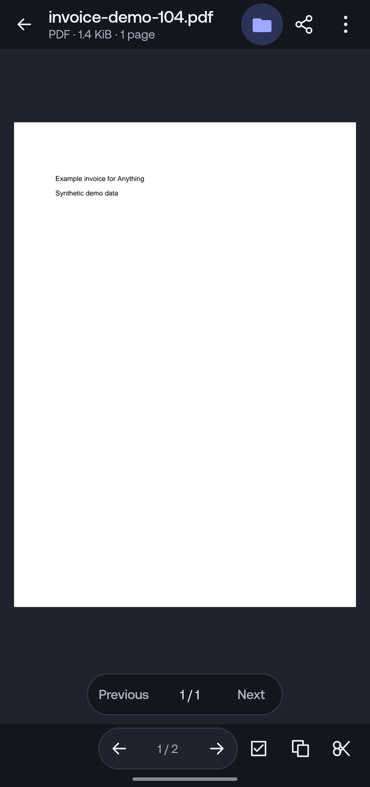

# Anything

**Find Android files by name as you type.** Anything is a free, MIT-licensed file search and file manager by CallCraft Studio. It keeps the filename index on your phone and runs on Android 8.0 and newer.

[Download build 2](https://github.com/shamrat05/anything/releases/tag/v1.0.0-build.2) · [User guide](GUIDE.md) · [Privacy](https://callcraftstudio.com/anything/privacy/) · [Support development](https://callcraftstudio.com/anything/support/)

## Download

| Signed APK | Choose it if |
| --- | --- |
| [Full APK](https://github.com/shamrat05/anything/releases/download/v1.0.0-build.2/anything-android-1.0.0.apk) | You want the direct-download build, including optional SMS search. |
| [Play-variant APK](https://github.com/shamrat05/anything/releases/download/v1.0.0-build.2/anything-play-1.0.0.apk) | You want to sideload the build that omits SMS access and search. |

[SHA-256 checksums](https://github.com/shamrat05/anything/releases/download/v1.0.0-build.2/SHA256SUMS-release.txt) · Version 1.0.0, build 2

Install one variant at a time. Open Anything, grant file access and let the first index finish. Later launches reuse the saved index and check for changes in the background. Shared-storage search works without root. For protected folders, select the root index scope on a rooted device and grant root access.

## What you can do

- **Find the file you half remember.** Try `invoice ext:pdf` to find PDF invoices. Narrow results by extension, folder, size or modified date, then sort by name, path, size or date. Browse in list, compact or grid view.
- **Check a file before opening another app.** Preview images, audio, video, PDFs, text and ZIP archives. Swipe between previews, or jump to a file’s folder from its path.
- **Tidy files right from the results.** Copy, move, rename, share or delete files. For a batch rename, select files and review the proposed names before applying them.
- **See what’s using space.** Open the storage map to find large files and folders. Use File Manager to browse one folder at a time, with recent folders and bookmarks.
- **Find more from the same search box.** Search launchable apps and, with permission, contacts. The Full APK can also search SMS when you enable it and grant access.



More examples and syntax are in the [query guide](core/README.md). For search help or a bug report, open **More actions → Help** or see [app support](SUPPORT.md).

## Build from source

Use x86-64 Linux (or x86-64 WSL on Windows). Install JDK 17, Python 3, Bash, Android SDK Platform 36, Build Tools 36.0.0 and NDK 28.2.13676358. Set `ANDROID_HOME` to your Android SDK directory. From the repository root, run:

```sh
bash scripts/build.sh :app:assembleFullDebug
```

The APK is written to `app/build/outputs/apk/full/debug/app-full-debug.apk`. Use `:app:assemblePlayDebug` to build without SMS access. The [user and maintainer guide](GUIDE.md) covers signing, tests and release packaging.

## Support development

If Anything saves you time, you can [support its development on Patreon](https://www.patreon.com/cw/Shamrat05/membership) with an optional $3, $10 or $15 monthly contribution. It helps fund maintenance, bug fixes and testing across Android devices. Everyone gets the same app features. See the [Anything support page](https://callcraftstudio.com/anything/support/) for funding and app support links.

## License

Copyright © 2026 CallCraft Studio. The project’s original software and documentation are licensed under the [MIT License](LICENSE). See [third-party notices](THIRD_PARTY_NOTICES.md) for separately licensed material.
