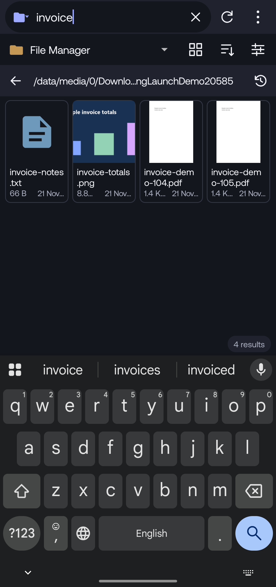
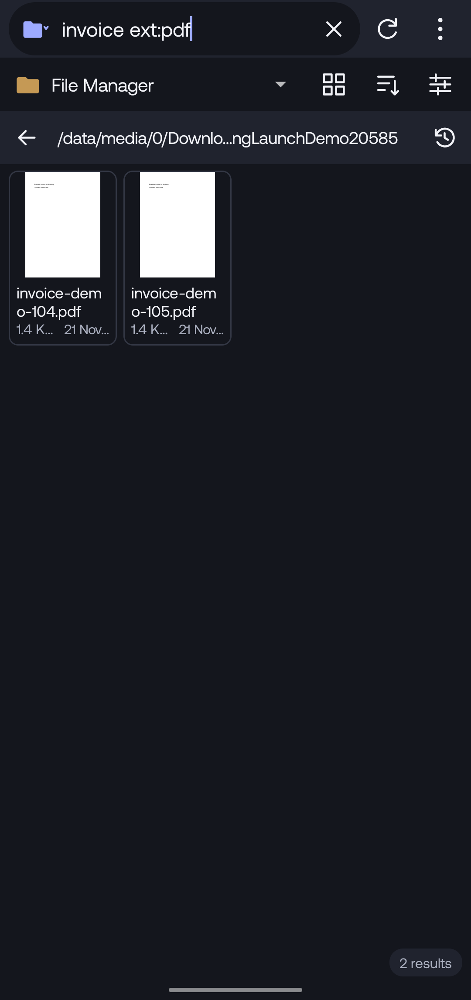
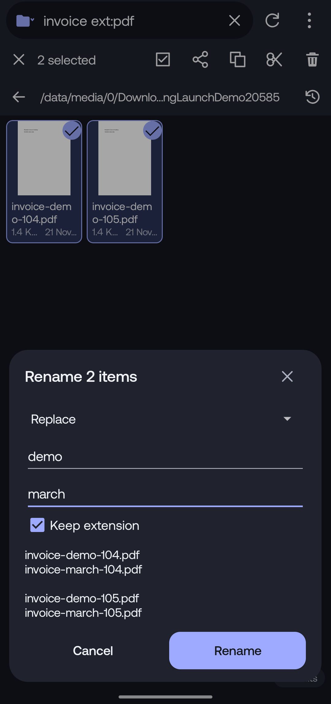
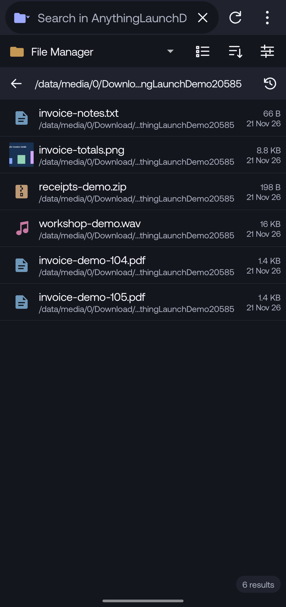

# Anything

**Building the fastest way to find anything on Android.**

Search Android filenames as you type. Anything is a free, MIT-licensed file search and file manager by CallCraft Studio. The index stays on your phone. Android 8.0 and newer.

[Download the latest release](https://github.com/shamrat05/anything/releases/latest) · [User guide](GUIDE.md) · [Privacy](https://callcraftstudio.com/anything/privacy/) · [Support development](https://callcraftstudio.com/anything/support/)

[](https://www.patreon.com/cw/Shamrat05/membership) [](https://callcraftstudio.com/anything/support/#usdt-tron)

## Download

| Download | What you get |
| --- | --- |
| [Anything for Android (recommended)](https://github.com/shamrat05/anything/releases/latest/download/anything-play.apk) | File search and management. |
| [Anything with SMS search](https://github.com/shamrat05/anything/releases/latest/download/anything-with-sms.apk) | The same app, plus optional text message search. |

[SHA-256 checksums](https://github.com/shamrat05/anything/releases/latest/download/SHA256SUMS-release.txt)

Install one variant at a time. Open Anything, grant file access and let the first index finish. Later launches reuse the saved index and check for changes in the background. Shared-storage search works without root. For protected folders, select the root index scope on a rooted device and grant root access.

## What you can do

- **Find the file you half remember.** Try `invoice ext:pdf` to find PDF invoices. Narrow results by extension, folder, size or modified date, then sort by name, path, size or date. Browse in list, compact or grid view.
- **Check a file before opening another app.** Preview images, audio, video, PDFs, text and ZIP archives. Swipe between previews, or jump to a file’s folder from its path.
- **Tidy files right from the results.** Copy, move, rename, share or delete files. For a batch rename, select files and review the proposed names before applying them.
- **See what’s using space.** Open the storage map to find large files and folders. Use File Manager to browse one folder at a time, with recent folders and bookmarks.
- **Find more from the same search box.** Search launchable apps and, with permission, contacts. The Full APK can also search SMS when you enable it and grant access.

### Explore more

- **Search with precision.** Combine file categories, select extensions, search within a folder, or use exclusions and regular expressions. Try `size:>10mb dm:today` to find larger files modified today.
- **Browse the way you like.** Pinch to change the layout, jump through results with the scrollbar, or go back to a recent or bookmarked folder. Search shared storage and mounted SD cards without root, or opt into a separate root index on a rooted phone.
- **Preview more formats.** Browse SVGs, Markdown, HTML and ZIP archives alongside PDFs, images, video and audio. Swipe through results or adjust playback speed in the built-in player.
- **Clean up a batch at once.** Select or invert a group, then copy, move or rename it. Bulk Rename can replace text, add prefixes or suffixes, and number files with a preview before you apply the changes.
- **Pick up where you left off.** The optional Last location setting restores your query, folder history and position. Light, dark and system themes are available, and you can hide dotfiles without rebuilding the index.

## See it in use

These are build 2 screenshots from a demo folder with sample files. Select any image to see it at full size.

| Search by name | Narrow by file type | Check a PDF | Preview a bulk rename |
| --- | --- | --- | --- |
| <a href="store/assets/anything-build-2-simple-search.png"></a> | <a href="store/assets/anything-build-2-filtered-search.png"></a> | <a href="store/assets/anything-build-2-pdf-preview.png"></a> | <a href="store/assets/anything-build-2-bulk-rename.png"></a> |

| Browse in a grid | Scan filenames in a list | See what takes up space |
| --- | --- | --- |
| <a href="store/assets/anything-build-2-grid-browse.png"></a> | <a href="store/assets/anything-build-2-list-browse.png"></a> | <a href="store/assets/anything-build-2-storage-map.png"></a> |

More examples and syntax are in the [query guide](core/README.md). For search help or a bug report, open **More actions → Help** or see [app support](SUPPORT.md).

## Build from source

Use x86-64 Linux (or x86-64 WSL on Windows). Install JDK 17, Python 3, Bash, Android SDK Platform 36, Build Tools 36.0.0 and NDK 28.2.13676358. Set `ANDROID_HOME` to your Android SDK directory. From the repository root, run:

```sh
bash scripts/build.sh :app:assembleFullDebug
```

The APK is written to `app/build/outputs/apk/full/debug/app-full-debug.apk`. Use `:app:assemblePlayDebug` to build without SMS access. The [user and maintainer guide](GUIDE.md) covers signing, tests and release packaging.

## Support development

A PDF lands in Downloads. Weeks later all you remember is the word `invoice`. Anything is for that moment. If it saves you time, you can help fund maintenance, bug fixes, and testing on real Android phones. Every feature stays free.

[](https://www.patreon.com/cw/Shamrat05/membership) [](https://callcraftstudio.com/anything/support/#usdt-tron)

Patreon offers optional $3, $10 and $15 monthly contributions. You can also make a one-time contribution with USDT. In either GitHub APK, open **More actions → Support development**. For help with the app, see [Support](SUPPORT.md).

### USDT on Tron (TRC20)

Send **USDT on Tron (TRC20)** only. The minimum deposit is **more than 0.01 USDT**. No memo or tag is needed.

```
TCURP3QhbasypbXJkb1ggTzQBYruYsuibv
```


## License

Copyright © 2026 CallCraft Studio. The project’s original software and documentation are licensed under the [MIT License](LICENSE). See [third-party notices](THIRD_PARTY_NOTICES.md) for separately licensed material.
