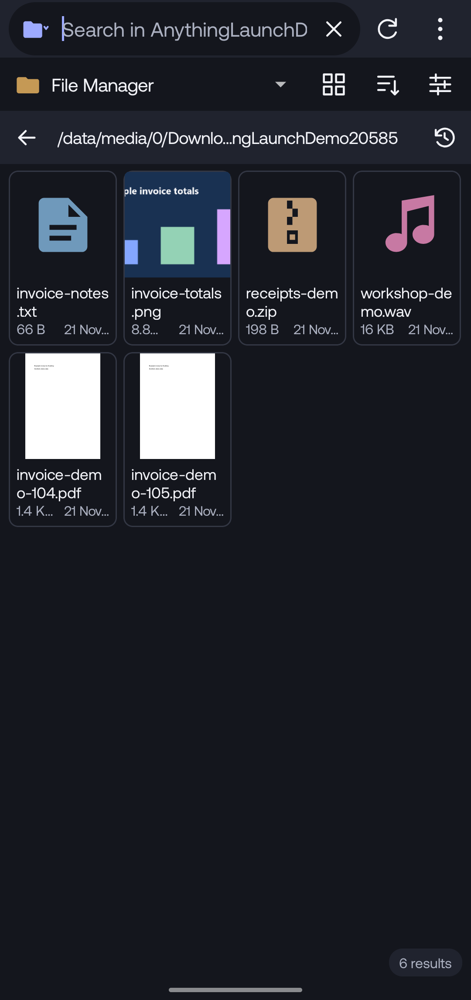
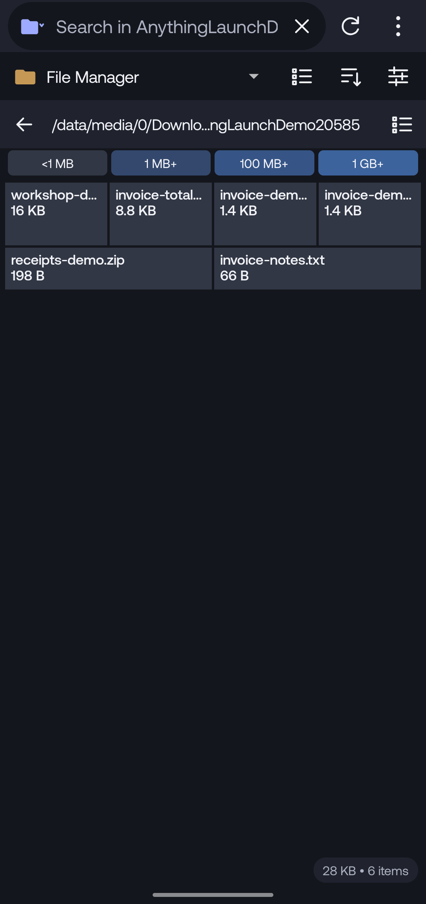

# Anything for Android

Find a file without remembering where it landed. Anything searches filenames on your device, opens common formats, and lets you move from a search result to its folder. The index stays on your phone. Android 8.0 or newer.

## Download

| Download | What it can access |
| --- | --- |
| **[Anything for Android](https://github.com/shamrat05/anything/releases/latest/download/anything.apk)** | Files you allow it to access, launchable apps, and contacts if you opt in. No SMS permission. |
| [Anything for Android with SMS access](https://github.com/shamrat05/anything/releases/latest/download/anything-with-sms.apk) | The same file tools, with optional SMS search and a read-only thread viewer. |

[Release notes](https://github.com/shamrat05/anything/releases/latest) · [SHA-256 checksums](https://github.com/shamrat05/anything/releases/latest/download/SHA256SUMS-release.txt)

Install one edition. When updating, choose the edition you already use and install it over the old version. Don't uninstall first.

## Search, browse, or free up space

- **Search** across accessible folders. Try `boarding ext:pdf` or `video size:>100mb`. Narrow results by file type, name, size, or date.
- **Files** shows one folder at a time. Open the sidebar beside the search field to switch folders or check used and available storage. Press and hold a file to open its actions without opening a preview. Choose Select items to work with multiple files. To use the compact alternative, turn on **More actions → Appearance → Quick preview file menu**. Open a single file’s popup to preview images, the first PDF page, or text; play supported audio/video on tap. Existing selection actions remain under **Show all file actions**.
- **Map** shows the relative space used by files and folders. Tap a folder to go inside. Tap a color in the size key to highlight that size, or tap it again to clear. List still shows every item.
- **Tabs** keep separate folders and searches open. Drag a tab's grip to reorder it, or tap the grip for move options.
- **Two-pane Files** keeps two folders open independently. Select files on one side, then explicitly confirm Copy or Move to the other. Existing files are never overwritten.
- **Preview** photos, video, audio, PDFs, text, and ZIP entries without leaving Anything. If an unfamiliar file is actually text, choose **Read as text**. Use **Open in another app** for formats that need a dedicated tool. Some image and audio/video codecs also depend on the device.
- **Office:** Open DOCX to read its main text and table rows. XLSX opens a grid of saved cell values: tap the worksheet name to switch sheets, or choose **Values as text** to select and copy. Quick Preview shows a few rows of the first visible worksheet. PPTX shows slide text and a basic visual preview when available. Office previews don’t recalculate formulas, run macros, reproduce every style, or edit the file. Use **Open in another app** for the full document or older Office formats.
- **Code and text:** Plain TXT keeps its original text with line numbers. Source files get selectable syntax colors based on their filename (including Java, Kotlin, JavaScript/TypeScript, Python, C/C++, Rust, Go, SQL, JSON, HTML/XML, and common config files such as OpenVPN and Android .prop). Use **Syntax** to choose a language manually. Source is displayed, never run. Large previews show the first 128 KiB or 2,000 lines; open another app for the full file.
- **Widgets:** Add Anything Search or Anything Files from your Android launcher. Search starts blank, and Files opens Internal storage. Neither widget shows your files on the home screen.
- **APK:** Tap a standalone APK to see its package name, version, and Android requirements. On the GitHub editions, **Install APK** opens Android's confirmation screen. The Play edition only inspects APKs. Only install APKs you trust. **Browse package contents** lists package paths with sizes and offers a read-only preview of eligible text and images. **Browse DEX classes** shows read-only Smali for a standalone DEX or standard DEX files inside an APK. It does not run code, produce Java source, edit or sign APKs.
- **Archives:** Open a ZIP, JAR, CBZ, TAR, TAR.GZ/TGZ, or GZIP and choose **Extract all**. Files go into a new folder without replacing anything. GZIP alone produces one file; TAR-family previews list names and sizes within a scan limit before you choose whether to extract. The 7z viewer lists up to 60 entries and can extract standard single-volume Copy, LZMA, or LZMA2 archives. For encrypted, split or filtered archives, links and special entries, larger archives, or RAR, use a dedicated archive app.

Open the three-dot menu for the guided tour, help, and **Check for updates**. The tour points directly to the controls, and you can skip or replay it. The update screen shows your installed version and links only to the matching GitHub APK or Google Play. GitHub updates go through Android’s installer. Anything doesn't check, download, or install updates in the background.

## Screenshots

These are real captures from an earlier build with sample files. Current controls differ.

| File grid | Storage map | Rename preview |
| --- | --- | --- |
|  |  |  |

## Help and source

[User guide](GUIDE.md) · [Search syntax](core/README.md) · [Support](SUPPORT.md) · [Privacy](https://callcraftstudio.com/anything/privacy/)

To build on x86-64 Linux or WSL, install JDK 17, Android SDK Platform 36, Build Tools 36.0.0, and NDK 28.2.13676358. Set `ANDROID_HOME`, then run:

```sh
bash scripts/build.sh :app:assembleGithubDebug
```

Use `:app:assembleFullDebug` for the optional SMS build. The guide covers signing and device checks. The app source is [MIT-licensed](LICENSE); bundled materials have [separate notices](THIRD_PARTY_NOTICES.md).
